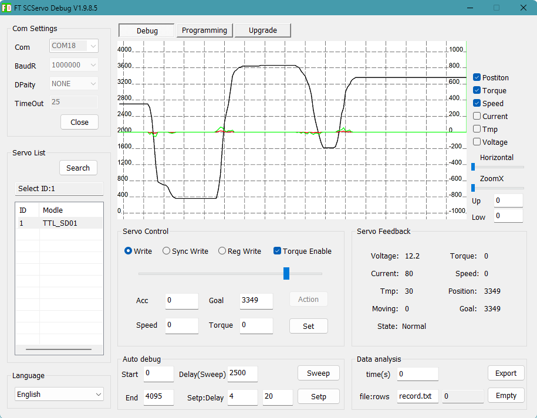

# Lygion Wiki

  <a class="ly-lang-switch__button" href="../">简体中文</a>

Welcome to the Lygion Robotics product Wiki.

Lygion Wiki is the product and technical documentation center for Lygion Robotics. It serves developers, engineers, makers, and product integrators with product guides, hardware wiring instructions, software tutorials, SDK examples, open-source project resources, and troubleshooting information.

Use this documentation to get started, connect hardware, configure devices, develop software, and integrate a system.

## First Steps

If you are new to Lygion TTL bus devices, choose a development route.

  

    
Recommended for a quick start

    
Python development

    

      For PCs, Raspberry Pi, Jetson, RK, and other single-board computers (SBCs).
    

    

      
Connect a TTL Adapter (A) over USB

      
Run a Python example to communicate with bus devices

      
Get started with robot projects on a computer or Python-capable board

    

    <a class="dev-route-button" href="quickstart/python-first-demo/">
      Start the Python route →
    </a>
  

  

    
For embedded development

    
C++ development

    

      For embedded MCUs such as ESP32S3, ESP32, STM32, and Arduino.
    

    

      
Connect an MCU UART to the TTL bus

      
Use Arduino IDE or PlatformIO

      
Run a C++ example to communicate with bus devices

      
Develop robot projects on embedded hardware

    

    <a class="dev-route-button" href="quickstart/cpp-first-demo/">
      Start the C++ route →
    </a>
  

!!! tip "Not sure which route to choose?"
    Choose **Python** for a PC, Raspberry Pi, Jetson, or N100 mini PC. Choose **C++** for an MCU board such as ESP32, STM32, or Arduino.

## Common Entry Points

### Basic setup with FD

!!! note "Who this is for"
    A beginner-friendly option with no development environment to set up. The graphical interface is useful for basic testing, configuration, and firmware updates.

    If you use a non-Windows system, follow the Python or C++ tutorials and the relevant product memory map to configure or debug devices in software.

{ .img-rounded width="450" }

FD is a Windows utility for testing and configuring bus devices through a graphical interface. For example, it can change the ID of a new device.

[FD utility guide](tutorials/fd-tool.md){ .md-button }

### Develop with Python

!!! note "Who this is for"
    Users developing robot projects in Python on a PC, Mac, Raspberry Pi, Jetson, RK board, or another SBC or host computer.

| What you want to do | Recommended guide |
| --- | --- |
| Connect a TTL bus device for the first time | [Python first demo](quickstart/python-first-demo.md) |
| Fix an unrecognized TTL Adapter (A) | [Install the USB serial driver](tutorials/install-usb-serial-driver.md) |
| Find where to enter commands | [Open a terminal, CMD, or PowerShell](tutorials/open-terminal.md) |
| Install Python or check its version | [Install Python](tutorials/install-python.md) |
| Find the serial port name | [Find the serial port](tutorials/find-serial-port.md) |
| Run an example script | [Run Python scripts](tutorials/run-python-scripts.md) |

### Develop with C/C++

!!! note "Who this is for"
    Users developing robot projects in C or C++ on an embedded MCU such as ESP32S3, ESP32, STM32, or Arduino.

| What you want to do | Recommended guide |
| --- | --- |
| Connect an MCU to a TTL bus device for the first time | [C++ first demo](quickstart/cpp-first-demo.md) |
| Develop with Arduino IDE | [Install Arduino IDE](tutorials/install-arduino-ide.md) |
| Develop with VS Code and PlatformIO | [Install PlatformIO](tutorials/install-platformio.md) |
| Connect an MCU UART to a TTL Adapter (A) | [MCU UART wiring basics](tutorials/mcu-uart-wiring.md) |
| Run an `.ino` example | [Upload an Arduino example](tutorials/upload-arduino-sketch.md) |
| View MCU output | [Use a serial monitor](tutorials/serial-monitor.md) |

### Bus product guides

!!! note "Who this is for"
    Readers who know the basics of bus devices and want to apply a specific product to a robot.

| Bus product | Product overview |
| --- | --- |
| [TTL Adapter (A)](reference/bus-devices/ttl-adapter-a/index.md) | Onboard USB-TTL chip converts a computer USB port or MCU UART into a single-wire TTL bus interface |
| [TTL Stepper Driver (A)](reference/bus-devices/ttl-stepper-driver-a/index.md) | TTL bus stepper driver with position, speed, synchronized, and other control modes |
| [TTL Encoder E02](reference/bus-devices/ttl-encoder-e02/index.md) | 12-bit, 360° absolute magnetic angle encoder |

## Documentation Sections

- **Quick Start**: Python and C++ tutorial routes for completing a first communication test.
- **Tutorials**: Cross-product guidance for terminals, Python and C++ environments, serial ports, drivers, power, IDs, and baud rates.
- **Product Wiki**: Hardware specifications, wiring, SDK examples, parameters, and FAQs for each product.
- **Downloads**: SDKs, utilities, open-source models, and related resources.

!!! tip "Suggested reading order"
    Python users can start with the [Python first demo](quickstart/python-first-demo.md), then open the guide for their product.

    MCU users can start with the [C++ first demo](quickstart/cpp-first-demo.md), then continue to the product's C++ or Arduino examples.

## Related Links

-   **Official website**  
    Lygion Robotics products and company information.  
    [lygion.ai](https://lygion.ai)

-   **GitHub**  
    SDKs, example code, and open-source projects.  
    [LygionOrganization](https://github.com/LygionOrganization/)

-   **Online documentation**  
    Choose the Wiki entry that works best on your network.  
    [GitHub Pages](https://lygionorganization.github.io/lygion-wiki/) ·
    [Aliyun](https://wiki.lygion.ai/)

-   **Taobao store**  
    Product purchases, kits, and support.  
    [Visit the store](https://shop349435383.taobao.com/)

