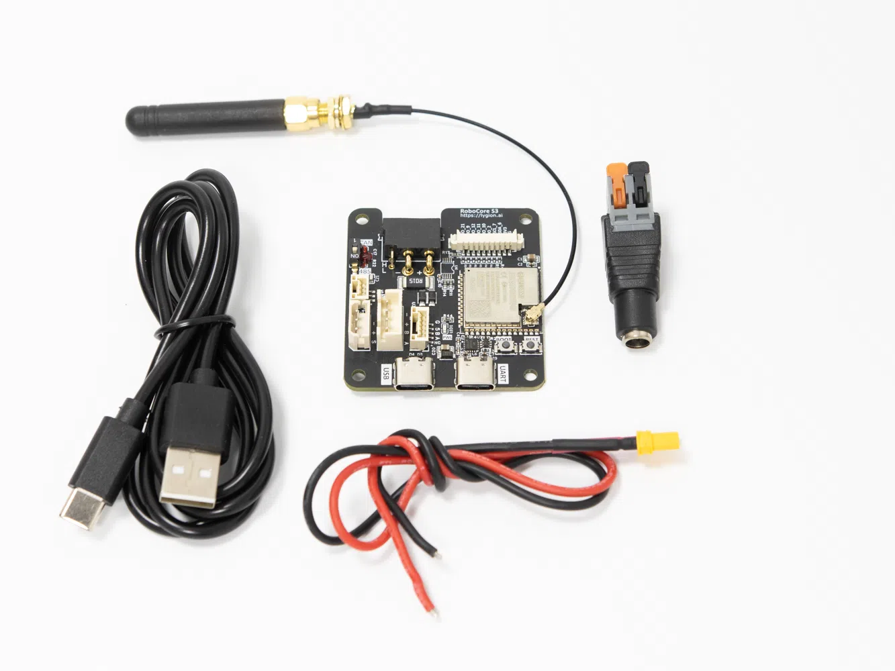
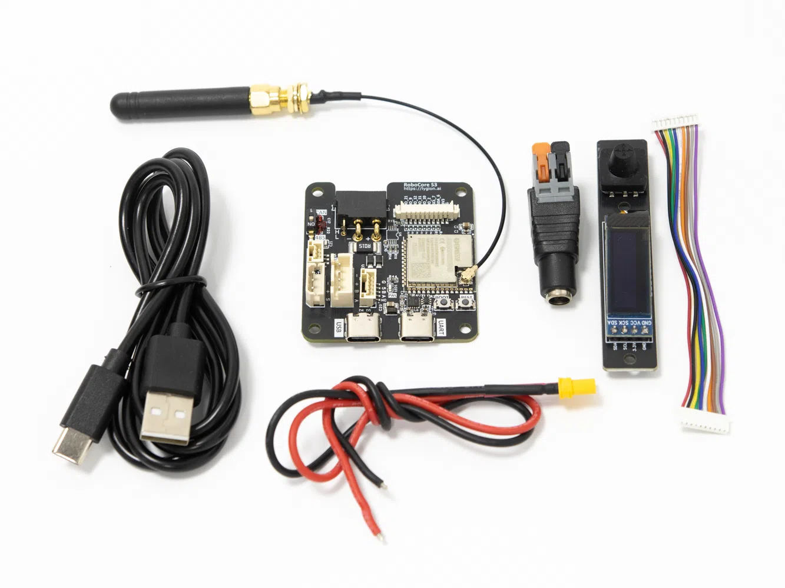
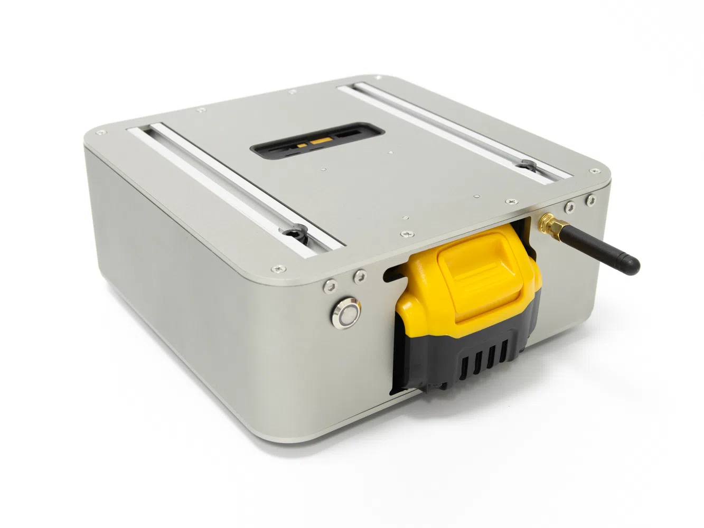
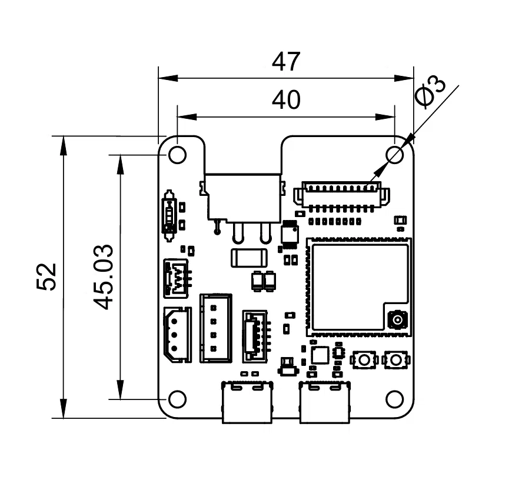
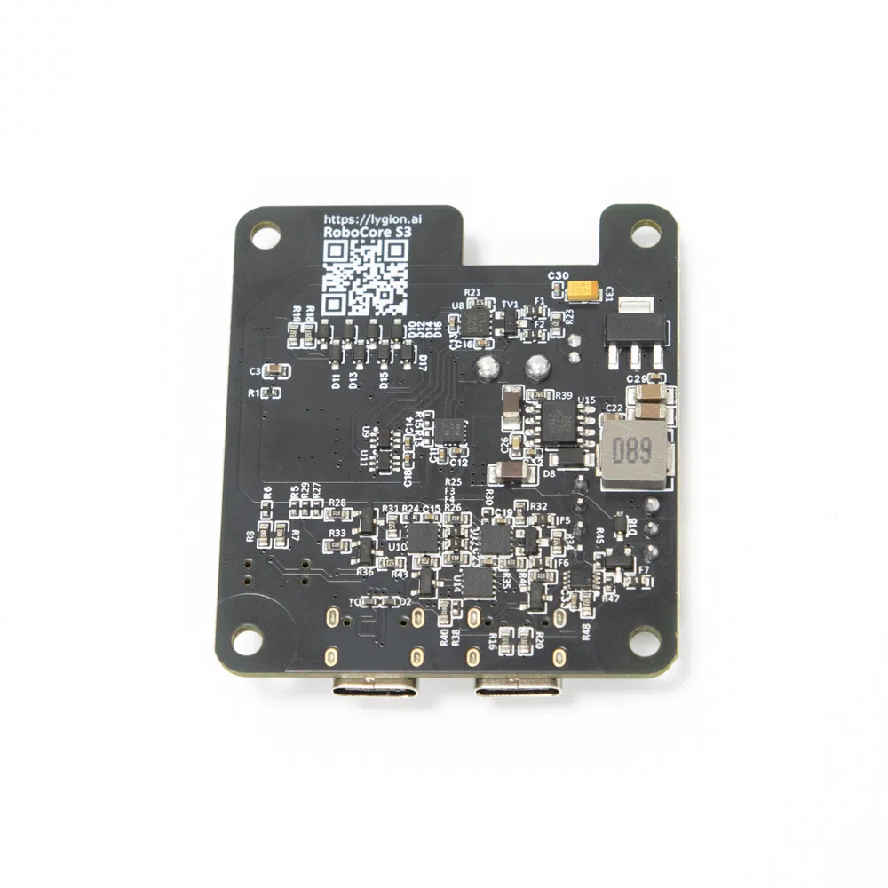
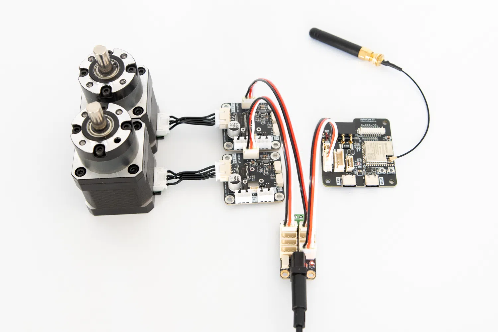
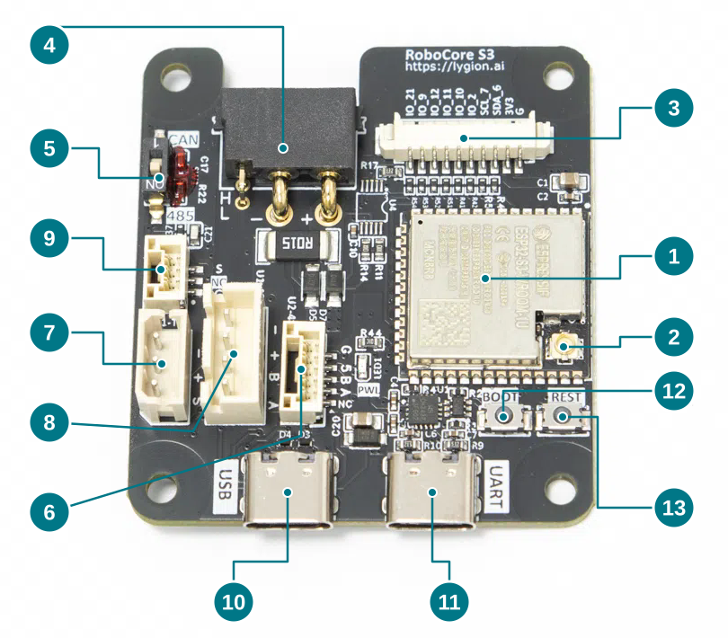
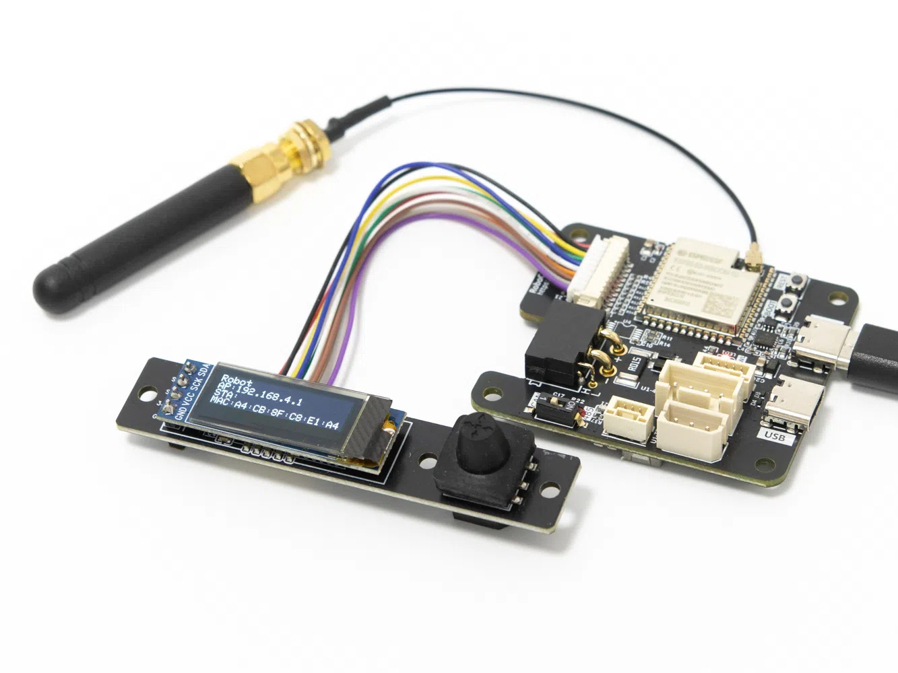

# 供电、接口与板载资源

## 包装清单

RoboCore S3 提供两种套装：套装一包含下列主板与基础配件；套装二在套装一的基础上增加 User Interface Module (A) 和配套连接线。

### 套装一

{ .img-rounded width="720" loading="lazy" }

| 配件 | 数量 | 用途 |
| --- | --- | --- |
| RoboCore S3 主板 | 1 | 机器人控制与设备通信 |
| DC5521 插座（母头），含快速接线端子 | 1 | 连接 DC5521 / DC5525 电源插头 |
| XT30U 母头配线，30 cm | 1 | 配线支持 10A 供电电流，无需焊接即可连接随附 DC5521 插座 |
| USB-A 转 USB-C 数据线，1 m | 1 | 下载程序及与电脑/上位机通信 |
| 2.4G 小辣椒穿板天线 | 1 | 支持穿板安装，将天线布置在金属机器人外壳外侧，便于无线信号传输 |

10A 为随附 XT30U 配线的额定能力；实际供电还应符合电源、插头插座及连接设备的额定值。

### 套装二

{ .img-rounded width="720" loading="lazy" }

包含**套装一的全部物品**，并增加：

| 配件 | 数量 | 用途 |
| --- | --- | --- |
| User Interface Module (A) | 1 | 包含五向开关按键、0.91 寸 OLED 屏幕和蜂鸣器，用于本地输入、显示与声音提示 |
| User Interface Module (A) 配套连接线 | 1 | 连接 RoboCore S3 与 User Interface Module (A) |

模块接口和使用说明见下方 [User Interface Module (A)](#user-interface-module-a)。

!!! warning "使用无线功能前连接外部天线"
    使用 Wi-Fi 或 ESP-NOW 前先接好外部天线。未连接天线会影响无线通信，并可能导致 ESP32-S3 模组发热。安装在金属外壳内时，可使用穿板安装把天线置于外壳外侧。

{ .img-rounded width="720" loading="lazy" }

穿板安装应用示例；机器人与金属外壳不属于套装。此图用于展示天线布置，不作为内部接线图。

## 尺寸与安装

{ .img-rounded width="720" loading="lazy" }

图中尺寸单位为 mm。安装时使用四个装配孔，并为插头、线缆与天线预留空间。

| 项目 | 参数 |
| --- | --- |
| 产品尺寸 | 47 × 52 mm |
| 装配孔数量 | 4 个 |
| 装配孔直径 | 3 mm |
| 装配孔中心间距 | 40 × 45 mm |
| 主控模组 | ESP32-S3-WROOM-1U-MCR8N8，8 MB Flash、8 MB PSRAM |
| 开发方式 | 开源例程，支持 PlatformIO 与 Arduino IDE |

{ .img-rounded width="600" loading="lazy" }

## 供电

### 动力电源与电流

RoboCore S3 支持 **5–48V 输入**，可通过 CAN 2+2 接口的 XT30 电源端、5264-3P TTL 或 XH2.54-4P 设备 RS485 接口供电。先按所连接设备的额定电压选择电源，再检查总电流需求。

| 接口 | 电压 / 用途 | 持续电流上限 |
| --- | --- | --- |
| XT30 电源端 | 主板及总线设备的动力输入，5–48V | 10A 输入 |
| 5264-3P TTL | 支持供电输入；动力电压跟随系统电源 | 6A 输出 |
| XH2.54-4P 设备 RS485 | 支持供电输入；动力电压跟随系统电源 | 6A 输出 |
| GH1.25-3P | 板间 TTL 通信与共地，用于供电解耦 | 不提供动力供电 |

TTL 和设备 RS485 接口**不会为设备单独降压**。例如，XT30 输入 24V 时，这两个接口的动力输出也为 24V。通过 XT30 供电时，两路输出及主板自身用电共同受 XT30 的 10A 输入上限约束，不能同时按 6A 满载使用；电源、线缆、转接插座的额定电流也应满足需求。

!!! warning "按所有共电设备的额定电压选择电源"
    主板支持 48V 不代表低压舵机也能接 48V。断电接线，按板上端子标识核对正负极、线序和设备额定电压。电机启动、堵转时的电流也应计入供电预算。

多组设备需要独立供电时，可通过 GH1.25-3P 连接总线 Hub，实现通信与动力供电解耦。参见[供电分组与解耦](../../../tutorials/power-grouping-and-decoupling.md)。

### 灵活的供电方式 { #flexible-power }

{ .img-rounded width="720" loading="lazy" }

将电源接入匹配的总线 Hub，再用一根 **5264-3P 连接线**连接 Hub 和 RoboCore S3，即可同时实现主板供电与 TTL 通信。执行器从 Hub 获取动力电，大电流无需经过 RoboCore S3，适合大功率系统，也能减少主板周边的电源走线。XH2.54-4P 设备 RS485 接口同样支持供电输入，可按设备总线类型选择连接方式。

- 供电电压须在主板的 **5–48V** 范围内，并符合 Hub 和所有共电设备的额定电压。
- 按电源、Hub、接口和线缆的额定电流配置负载；上表的 6A 为总线口的输出上限，不代表任意接法均可承载该电流。
- XT30、5264-3P 和 XH2.54-4P 的动力端共用电源，不要直接并联独立电源。

此接法与 **GH1.25-3P 分组供电**不同：5264-3P 同时传输动力电与通信；GH1.25-3P 只连接 TTL 通信与共地，主板和执行器组分别供电。Hub、驱动器、电机及外接电源需另备。

### USB 与 XT30 同时连接

支持 USB 与 XT30 同时连接：USB 用于主板通信、下载或供电，XT30 为总线设备提供动力电源。主板电源不会经 USB 向电脑倒灌；**仅连接 USB 不会为动力接口供电**。

两路 Type-C 的 VBUS 在板内相连，不属于相互隔离的两个电源输入；不要将两个独立 USB 电源作为并联供电方案。

主板自身待机功耗小于 0.2W，运行包含 Wi-Fi 的 Web 应用时小于 0.7W；这些数值不包含外接设备，也不代表瞬时峰值功耗。

### 辅助 5V 与 3.3V

辅助输出用于小功率外设，与 TTL / RS485 的动力输出不同。

| 输出 | 来源 | 使用限制 |
| --- | --- | --- |
| GH1.25-5P 的 5V | SCT2A27 内置 LDO | 200mA 级电源，负载不超过 200mA；带载电压受 LDO 压差影响 |
| 扩展接口的 3.3V | 5V0 经 AMS1117-3.3S 降压 | 1A 级总输出，由主板和外设共享；可供外设使用的电流还受温升限制 |

**接口及布线支持 1A，不等于外设可取用 1A。** 3.3V 需要为 ESP32-S3、IMU、收发器等板载器件保留电流余量，不能把稳压器的总输出能力全部分配给外设。较大负载应使用独立稳压电源，并按通信接口要求共地；主板不为树莓派供电。

辅助 5V、3.3V 均作为输出使用，不要接入动力电压，也不要直接并联另一设备的电源输出。

??? info "电源电路说明：5V0 与 5V 是不同网络"
    原理图中，U15 SCT2A27 的开关输出经 L2 电感产生 **5V0**。芯片的 DC-DC 支持 2A 连续输出，但这不是外部辅助 5V 接口的额定电流。

    - **辅助 5V**：5V0 接入 U15 的 VBIAS，经过芯片内置的 200mA LDO，从 LDO 引脚输出到 GH1.25-5P。输入本身约为 5V，缺少稳压压差，因此不能把它理解为在 200mA 负载下仍保证精确 5V 的输出；选外设时应核对其允许供电范围。
    - **3.3V**：5V0 经 U13 AMS1117-3.3S 降压。LDO 热耗约为 `(5 − 3.3) × 总输出电流`；总电流 0.5A 时约为 0.85W，1A 时约为 1.7W。可持续供电能力取决于主板负载、环境温度和散热，不能仅用 1A 减去平均功耗换算值来确定外设峰值预算。

    芯片规格见 [SCT2A27 厂商数据手册](https://www.silicontent.com/uploads/20250604/3729c2375b93fd8db1c210f6d7f306ab.pdf)。芯片额定能力与整板外设可用电流是不同概念。

### 保护范围

| 电路 | 保护作用与边界 |
| --- | --- |
| 主板 DC-DC 支路 | 具有限流、欠压、输出过压与过温保护；不等于动力输出具有这些保护 |
| USB | 数据线带 ESD 保护，供电路径阻止主板电源回流至电脑 |
| CAN、设备 RS485 | 信号线带自恢复保险丝与瞬态钳位器件 |
| 外部 RS485（GH1.25-5P） | 信号线带自恢复保险丝 |
| 单线 TTL | 信号线带自恢复保险丝与钳位器件 |

动力通路没有整路反接切断或过流断电电路。上述信号保护不能替代动力电源保护；按系统需求在外部配置保险丝或限流电源。RESET 和软件停止指令也不切断动力供电。

## 板载接口与资源

观察方向：主板正面朝上，两个 Type-C 接口朝下。图中编号与下表对应，可打开原图查看接口丝印。IMU 单独列出，不标注正面位置。

{ .img-rounded width="720" loading="lazy" }

[查看完整板载资源编号图](assets/board-resources.svg)

| 编号 | 接口 / 资源 | 信号 | 用法 |
| --- | --- | --- | --- |
| 01 | ESP32-S3 主控模组 | ESP32-S3-WROOM-1U-MCR8N8 | 8 MB Flash / 8 MB PSRAM；运行控制固件与无线通信 |
| 02 | IPEX1 天线接口 | 2.4 GHz 外接天线 | 使用 Wi-Fi 或 ESP-NOW 前先连接天线 |
| 03 | PH1.25-10P 扩展口 | IO6 SDA、IO7 SCL、IO2、IO9、IO10、IO11、IO12、IO21，3.3V、GND | 连接 Lygion User Interface Module (A) |
| 04 | CAN 2+2 | CAN H/L，XT30 电源端 | 为主板供电；CAN 档时使用 IO13 RX、IO14 TX 通信 |
| 05 | CAN/RS485 选择开关 | IO13 RX、IO14 TX | 选择外部通信的 CAN 或 RS485 物理通路 |
| 06 | GH1.25-5P | RS485 A/B、GND、5V 输出 | 485 档时使用 IO13 RX、IO14 TX 通信 |
| 07 | 5264-3P | IO4 TX、IO5 RX，经单线 TTL 电路 | 单线 TTL 总线设备；动力供电等于 XT30 输入 |
| 08 | XH2.54-4P | IO4 TX、IO5 RX，经 RS485 电路 | RS485 总线设备；动力供电等于 XT30 输入 |
| 09 | GH1.25-3P | 单线 TTL | 板间 TTL 通信、供电解耦 |
| 10 | Type-C USB | IO19 USB D−、IO20 USB D+ | ESP32-S3 原生 USB；用于 USB CDC 上位机通信，减少串口桥接瓶颈 |
| 11 | Type-C UART | TXD0 / RXD0，经 USB 转串口 | 程序下载、串口调试；带自动下载电路 |
| 12 | BOOT 按键 | IO0，按下为低 | 配合 RESET 手动进入下载模式 |
| 13 | RESET 按键 | EN，按下为低 | 按住时主控保持复位，松开后重新启动；不是整板电源断开开关 |
| — | QMI8658A 六轴板载 IMU | IO6 SDA、IO7 SCL | 三轴加速度、三轴角速度；与外接 OLED 共用 I²C |

## CAN/RS485 开关注意事项

!!! warning "外部通信与设备总线使用不同的引脚"
    **CAN 档：IO13 为 RX、IO14 为 TX，通过 CAN 2+2 接口进行 CAN 通信。**
    **485 档：同一对 IO13 RX、IO14 TX，通过 GH1.25-5P 进行外部 RS485 通信。**
    这两种外部通信复用同一组 GPIO，不能同时使用；开关只切换硬件通路，程序也必须运行对应 CAN 或 UART 协议。停止通信后再切换档位。

外部 RS485（IO13/IO14）与总线设备 RS485（IO4/IO5）独立，可分别通信。**总线设备 RS485 与单线 TTL 共用 IO4 TX、IO5 RX**：它们不是两条独立串口，使用同一 UART 的数据和波特率；同时连接时应避免重复 ID 和响应冲突。CAN/RS485 选择开关不改变这组设备总线引脚。

CAN 例程为 500 kbps，需要匹配波特率的对端和共地。板上有 120Ω CAN 终端电阻，组网时需考虑各节点已有终端，避免每个节点都叠加终端。外部 RS485 例程为 115200、8N1，板上自动控制收发方向；双方应协调半双工发送。详见 [Arduino 例程](arduino.md)。出厂 JSON 接口与单元通信例程的协议不同，不应假设将开关拨到 485 就会自动出现 JSON 网关。

## User Interface Module (A)

{ .img-rounded width="720" loading="lazy" }

套装二随附此模块及配套连接线。通过 PH1.25-10P 扩展口连接，提供五向开关按键、0.91 寸 OLED 屏幕和蜂鸣器提醒。这些器件位于外接模块上。

| 功能 | GPIO / 参数 |
| --- | --- |
| 上 / 下 / 左 / 右 / 确认 | IO10 / IO11 / IO12 / IO9 / IO2，低电平有效 |
| 蜂鸣器 | IO21 |
| OLED | SDA IO6、SCL IO7，SSD1306 128×32，地址 0x3C |
| 板载 IMU | 同一 I²C 总线，驱动探测 0x6A / 0x6B |

`User_Interface_Module_A` 例程包含按键去抖、短鸣和屏幕显示；没有 OLED 时仍可读取按键。不要在 OLED 和板载 IMU 驱动里重复改变 Wire 引脚。

## 下载与 USB 通信

- **Type-C UART**：自动下载电路配合下载工具操作 DTR/RTS，正常下载无需手动按 BOOT。
- **Type-C USB**：手动进入下载模式时，按住 BOOT，按下并松开 RESET，然后松开 BOOT，再选择出现的 USB 端口下载。
- **正常运行**：原生 USB 可使用 USB CDC 交换 JSON 指令，通常比经过串口桥接更高效；实际吞吐取决于固件和上位机处理，不等于电机执行速率。

连接后通过设备管理器确认端口。使用可传输数据的线缆，并关闭占用端口的串口监视器。恢复完整固件参见[固件恢复](firmware.md)。
