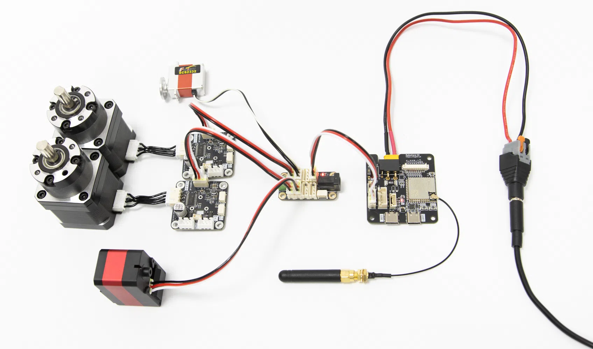
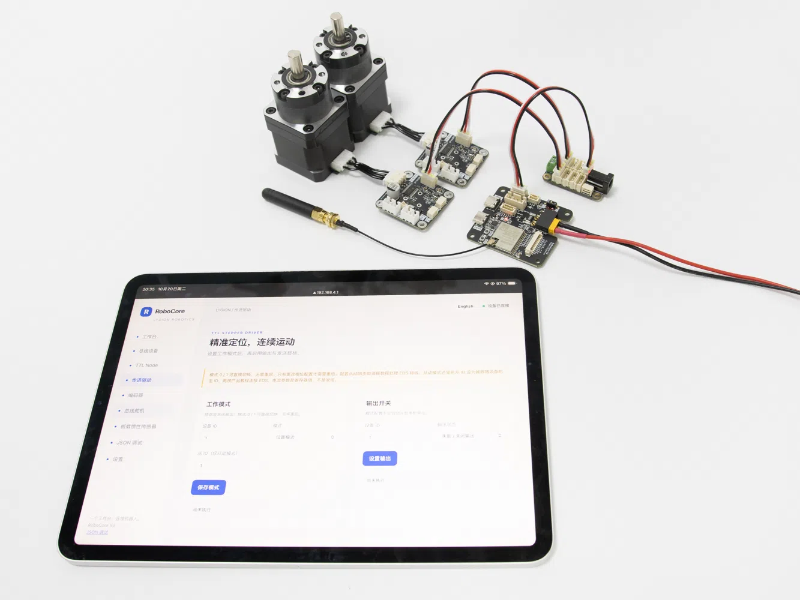

# 快速开始：不用写代码

使用无线功能前先连接包装内的外部天线；配件及穿板安装说明见[包装清单](hardware.md)。

## 准备

- RoboCore S3、可传输数据的 USB Type-C 线、手机或电脑。
- 一个总线设备与对应线缆；选择符合该设备额定电压的外部电源。
- 第一次只接一个设备，避免默认 ID 重复。

## 1. 连接电源和总线

断电接线，按板上标识确认动力正负极、GND 与 TTL。USB 用于主控通信，不代表外部执行器已获得动力供电。RoboCore S3 的动力输出跟随输入电压。

{ .img-rounded width="720" loading="lazy" }

总线设备连接实拍；演示设备与外接电源需另备。照片展示多设备连接关系，首次测试仍按上文只连接一个设备；供电电压按该设备额定值选择。

## 2. 连接热点

出厂默认热点为 `Robot`，密码 `12345678`。手机提示“无法上网”时仍保持连接；临时关闭会自动切回移动网络的功能。在浏览器地址栏输入 `http://192.168.4.1`，不要输入搜索框。

若热点名称已经被修改，使用当前配置；可在 OLED 或路由器设备列表查看地址。页面默认英文，可点击右上角“中文”切换后按下文操作。

{ .img-rounded width="720" loading="lazy" }

平板与演示设备不属于套装。各页面功能见[网页控制台](web-console.md)。

## 3. 扫描 ID

打开“总线设备”，默认扫描 0–253。确认主控波特率与设备一致（示例默认 1Mbps）。扫描结果只显示 ID，不判断型号；点击 ID 后会自动填入组件。

没有结果时先检查动力供电与线序，再检查波特率。同 ID 的两个设备不能通过扫描可靠区分，应分别连接后改成不同 ID。

## 4. 完成第一次读取

- TTL Encoder E02：打开“编码器”→“读取编码器”。手动转动轴，确认位置变化。
- TTL Node：打开“TTL Node”→“读取通道”，检查 S.BUS 寄存器反馈。
- 步进驱动：打开“步进驱动”→“读取状态”，确认 ID 和通信正常，再按下一章使能与低速运动。

## 5. 保存网络设置

“设置”中可以修改热点、连接路由器。应用后原连接可能断开；重新连接新热点，或使用路由器分配的 IP。无需把板接入互联网。

下一步：[设备控制步骤](devices.md)。出现问题请查看[故障排查](faq.md)。

## Wi-Fi 频段与 STA 连接

RoboCore S3 使用 2.4 GHz Wi-Fi。连接其热点的设备需支持 2.4 GHz Wi-Fi；常见手机、平板和笔记本通常都支持，一般无需额外设置。连接路由器时，请使用已开启 2.4 GHz 频段的网络，不能连接仅提供 5 GHz / 6 GHz 的网络。

在网页「设置」填写路由器 SSID 和密码后应用配置，页面会显示 STA 连接中、已连接或连接未成功。成功后显示 STA IP；连接 UI Module (A) 时，OLED 同步更新。密码旁的眼睛按钮可切换明文。连接失败不会清空配置；检查网络和密码后可再次应用。修改热点或切换信道可能使浏览器断连，请重新连接主板热点后查看状态。
